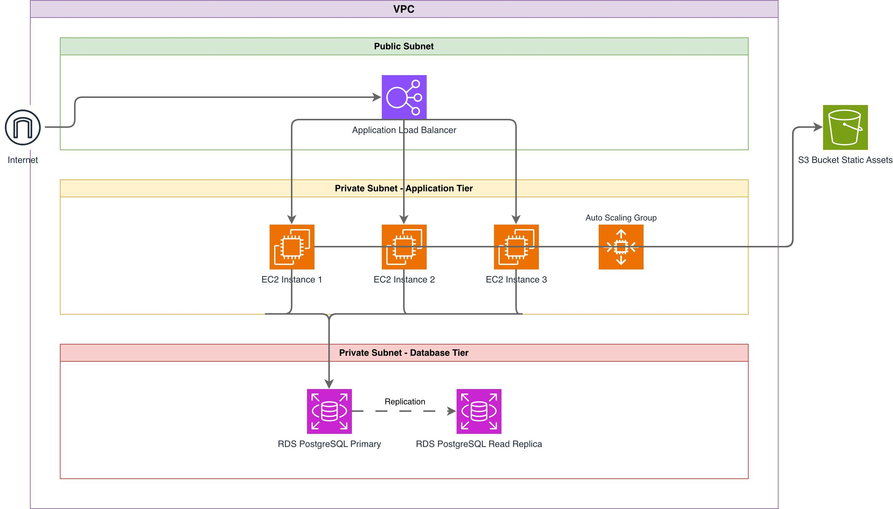

# AWS Three-Tier Java Application using Spring Boot and Terraform

AWS portfolio project using a Java 17 Spring Boot application, Amazon EC2, Application Load Balancer, private Amazon RDS PostgreSQL, IAM roles, Secrets Manager, CloudWatch, S3, Terraform, and GitHub Actions.

> **Learning project notice:** It uses HTTP for the demo ALB endpoint, one NAT Gateway to reduce cost, a single-AZ RDS instance, and a Terraform-managed database secret. Review security and cost notes before deployment.

## 1. What you will build

A browser sends a request to a public Application Load Balancer. The ALB forwards traffic to two Spring Boot Java application instances in private subnets across two Availability Zones. The application reads its PostgreSQL credentials from AWS Secrets Manager using an EC2 IAM role and increments a visit counter in Amazon RDS.

Terraform provisions the infrastructure. GitHub Actions builds and tests the Java application when code is pushed or a pull request targets `main`.

## 2. Architecture



### Request flow

1. User opens the ALB URL.
2. ALB forwards HTTP requests to healthy EC2 instances on port 8080.
3. Spring Boot retrieves the database secret using its EC2 IAM role.
4. Java connects to PostgreSQL on port 5432 and increments the visit counter.
5. CloudWatch collects application logs and monitors unhealthy ALB targets.

## 3. Core cloud concepts

| Concept / service | Purpose |
|---|---|
| AWS Region | Geographic area where AWS resources are created |
| Availability Zones | Separate locations within a Region |
| VPC | Isolated virtual network for this application |
| Public subnet | Contains the internet-facing ALB and NAT Gateway |
| Private subnet | Contains EC2 application instances |
| Database subnet | Contains private RDS database networking |
| Internet Gateway | Provides internet routing for public subnet resources |
| NAT Gateway | Lets private instances initiate outbound connections |
| Route table | Controls where subnet traffic is routed |
| EC2 | Virtual machines that run the Java application |
| Auto Scaling Group | Maintains two application instances |
| Application Load Balancer | Distributes HTTP traffic and checks target health |
| RDS PostgreSQL | Managed relational database |
| IAM role | Gives EC2 temporary permissions without embedded access keys |
| Secrets Manager | Stores database credentials |
| S3 | Private bucket reserved for project artifacts |
| CloudWatch | Application log collection and ALB health alarm |
| Terraform | Infrastructure as Code |
| Maven | Builds and tests the Java application |
| Spring Boot | Java framework used to create web endpoints and the page |
| GitHub Actions | Automated Java build and test workflow |

## 4. Project structure

```text
aws-three-tier-java-project/
├── README.md
├── .gitignore
├── app/
│   ├── pom.xml
│   ├── Dockerfile
│   └── src/
│       ├── main/java/com/example/clouddemo/
│       │   ├── CloudDemoApplication.java
│       │   ├── DatabaseConfig.java
│       │   └── HomeController.java
│       ├── main/resources/
│       │   ├── application.properties
│       │   └── templates/index.html
│       └── test/java/com/example/clouddemo/
│           └── CloudDemoApplicationTests.java
├── terraform/
│   ├── versions.tf
│   ├── provider.tf
│   ├── variables.tf
│   ├── main.tf
│   ├── outputs.tf
│   ├── user_data.sh.tftpl
│   └── terraform.tfvars.example
├── architecture/
│   └── architecture-diagram.png
└── .github/workflows/ci.yml
```

## 5. Prerequisites

Install:
- Java Development Kit (JDK) 17
- Apache Maven 3.9+
- AWS CLI v2
- Terraform 1.6+
- Git
- A GitHub account
- An AWS account

Use an IAM identity with only the permissions needed for this lab. Do not use root account access keys. Never commit credentials, Terraform state, or real `.tfvars` files.

## 6. Build and test Java locally

From the repository root:

```bash
cd app
mvn clean test
mvn clean package
```

The executable JAR should be created at:

```text
app/target/aws-three-tier-java-1.0.0.jar
```

Run it locally only after providing a valid `DB_SECRET_ARN` and AWS credentials that can read the secret and connect to the database. For a first local check, use the build and test commands above; the CI test does not need a live AWS database.

## 7. Push the project to GitHub before deploying

The EC2 user-data script clones this repository during instance startup. Therefore, make the repository public for this learning exercise, or adapt the bootstrap process to authenticate securely to a private repository.

1. Create a GitHub repository named `aws-three-tier-java-project`.
2. Push this project to the `main` branch.
3. Copy the HTTPS clone URL.
4. Confirm the repository can be cloned without signing in.

Example:

```bash
git init
git add .
git commit -m "Initial AWS three-tier Java project"
git branch -M main
git remote add origin https://github.com/YOUR_GITHUB_USERNAME/aws-three-tier-java-project.git
git push -u origin main
```

Do not push `terraform.tfvars`, AWS credentials, private keys, or state files.

## 8. Configure AWS CLI

```bash
aws configure
aws sts get-caller-identity
```

The second command should show the AWS account and identity you intend to use. Do not put AWS access keys in source files or Terraform variables.

## 9. Configure Terraform

```bash
cd ../terraform
```

Create your local variables file:

**Windows PowerShell**
```powershell
Copy-Item terraform.tfvars.example terraform.tfvars
```

**macOS / Linux**
```bash
cp terraform.tfvars.example terraform.tfvars
```

Edit `terraform.tfvars`:
- Replace `YOUR_GITHUB_USERNAME` with your GitHub username.
- Confirm the repository URL is correct and publicly cloneable.
- Use your public IP with `/32` for `allowed_http_cidr` if you want to restrict ALB access.
- Select a supported AWS Region and instance classes.

Then run:

```bash
terraform init
terraform fmt -recursive
terraform validate
terraform plan
```

Review the plan carefully. It creates billable NAT Gateway, RDS, ALB, EC2, Elastic IP, Secrets Manager and other resources.

If the plan is correct:

```bash
terraform apply
```

Type `yes` only after reviewing the planned changes.

## 10. Open and test the application

Get the URL:

```bash
terraform output application_url
```

Wait for EC2 bootstrapping and ALB target health checks. EC2 instances clone the public GitHub repository, install Java and Maven, build the Spring Boot application, and start it as a systemd service.

Open the URL in your browser. Refresh the page; the visit count should increase.

Test endpoints:

```bash
curl "$(terraform output -raw application_url)/health"
curl "$(terraform output -raw application_url)/ready"
```

Expected health response:

```json
{"status":"ok","service":"spring-boot"}
```

The `/ready` endpoint returns success only when the application can query the database.

## 11. Terraform file guide

- `versions.tf`: Terraform and provider version requirements.
- `provider.tf`: AWS provider and default tags.
- `variables.tf`: configurable inputs.
- `main.tf`: networking, security groups, ALB, EC2 Auto Scaling, RDS, IAM, Secrets Manager, S3 and CloudWatch.
- `user_data.sh.tftpl`: installs Java/Maven, clones the repository, builds the JAR and starts the application.
- `outputs.tf`: application URL, RDS endpoint, S3 bucket and VPC ID.

Terraform workflow:

```text
Write configuration
       |
terraform init
       |
terraform fmt / validate
       |
terraform plan
       |
terraform apply
       |
AWS infrastructure created
       |
terraform destroy
```

Terraform state can contain sensitive information. It is ignored by Git but is not automatically encrypted when stored locally. For team or long-lived environments, configure protected remote state with encryption, versioning, restricted IAM access and a locking strategy supported by your Terraform version.

## 12. Security design

- ALB is the only public application entry point.
- EC2 instances are in private subnets and have no public IPs.
- App security group accepts port 8080 only from the ALB security group.
- RDS is not publicly accessible and accepts port 5432 only from the app security group.
- EC2 uses an IAM role to read only the project's Secrets Manager secret.
- EC2 requires IMDSv2.
- S3 public access is blocked.
- RDS storage encryption is enabled.
- No SSH ingress is configured.

### Production hardening still required

- Add HTTPS with ACM and an HTTPS ALB listener; redirect HTTP to HTTPS.
- Use Multi-AZ RDS, deletion protection, longer backup retention and final snapshots.
- Use a highly available NAT design if private subnet outbound connectivity must survive an AZ failure.
- Protect Terraform state using an encrypted remote backend and strict IAM permissions.
- Avoid storing secret values in Terraform state; this demo's generated database password is in Terraform state, so protect that state.
- Use a secure deployment method for private Git repositories rather than putting tokens in user data.
- Add WAF, vulnerability scanning, patch management and more detailed monitoring.
- Run application processes as a non-root OS user and review IAM permissions.

This is a portfolio demonstration, not a production deployment.

## 13. GitHub Actions CI

`.github/workflows/ci.yml` runs when code is pushed or a pull request targets `main`. It installs Java 17, caches Maven dependencies and runs:

```bash
mvn --batch-mode clean verify
```

To check it:
1. Push the project to GitHub.
2. Open the repository's **Actions** tab.
3. Select **Java application CI**.
4. Confirm the build-and-test job passes.

This workflow builds and tests code. It does not deploy the AWS infrastructure.

## 14. Testing checklist

- [ ] `mvn clean test` succeeds locally.
- [ ] `mvn clean package` creates the executable JAR.
- [ ] `terraform fmt -check -recursive` succeeds.
- [ ] `terraform validate` succeeds.
- [ ] Terraform plan contains only expected resources.
- [ ] GitHub Actions Java CI succeeds.
- [ ] ALB target group shows healthy instances.
- [ ] Application URL displays the Java application.
- [ ] `/health` returns HTTP 200.
- [ ] `/ready` returns HTTP 200 after database connectivity is ready.
- [ ] Refreshing the page increments the PostgreSQL counter.
- [ ] EC2 instances have no public IP addresses.
- [ ] RDS is not publicly accessible.
- [ ] App security group only permits port 8080 from ALB security group.

## 15. Troubleshooting

**ALB returns 503**
- Wait for instance bootstrapping to finish.
- Check target group health in EC2 > Load Balancers > Target Groups.
- Check EC2 system logs and CloudWatch application logs.
- Confirm the Spring Boot process is listening on port 8080.

**Instance failed to clone the repository**
- Confirm the GitHub repository is public.
- Confirm `application_repo_url` and `application_branch` are correct.
- Check the instance can reach the internet through the NAT Gateway.

**Maven build fails on EC2**
- Check Maven Central connectivity and the instance bootstrap log.
- Confirm the code builds locally with Java 17 and Maven.

**`/health` works but `/ready` fails**
- Check RDS status and endpoint.
- Check port 5432 security group source.
- Check the Secrets Manager secret and EC2 IAM permissions.
- Review application logs.

**Terraform credential error**
- Run `aws sts get-caller-identity`.
- Configure AWS CLI or select the intended profile.
- Never paste access keys into `.tf` files.

## 16. Cleanup — avoid ongoing AWS charges

From the Terraform directory:

```bash
terraform destroy
```

Review the plan and type `yes` to confirm. Then check the AWS Console in your selected Region for leftover resources, especially NAT Gateway, Elastic IP, Load Balancer, EC2 instances, Auto Scaling Group, RDS, Secrets Manager secret, S3 bucket and CloudWatch log group.

The S3 bucket is configured for force deletion. If you modify that setting or add other buckets, empty them before deletion. Confirm resources are gone.

## 17. Interview questions and answers

**1. What is a VPC?**  
A logically isolated virtual network in AWS where I configure IP ranges, subnets, routes and security.

**2. What is the difference between a public and private subnet?**  
A public subnet has a route to an Internet Gateway. A private subnet does not have direct inbound internet routing. Here, ALB is public while EC2 and RDS are private.

**3. What does a NAT Gateway do?**  
It lets private subnet resources initiate outbound internet connections without exposing them directly to unsolicited inbound connections.

**4. Why use two Availability Zones?**  
To spread application instances across separate AZs and reduce the impact of an AZ-level failure.

**5. What is an Application Load Balancer?**  
A Layer 7 load balancer that routes HTTP/HTTPS requests to targets and performs health checks.

**6. What is an Auto Scaling Group?**  
A service that maintains a desired number of EC2 instances and can replace unhealthy instances.

**7. Why use a security group?**  
It acts as a stateful virtual firewall controlling inbound and outbound traffic for associated resources.

**8. Why use an IAM role on EC2?**  
It provides temporary credentials to the application so it can call AWS services without embedded access keys.

**9. Why is RDS private?**  
The database should not accept direct public internet connections. Only the application tier needs database access.

**10. What is Secrets Manager?**  
A managed service for storing and retrieving secrets such as database credentials.

**11. What is Spring Boot?**  
A Java framework that simplifies building stand-alone applications and web services.

**12. What is Maven?**  
A build and dependency management tool used here to compile, test and package the Java application.

**13. What is Terraform?**  
An Infrastructure as Code tool that describes cloud resources declaratively and manages changes through plan and apply.

**14. What is Terraform state?**  
A record mapping Terraform configuration to real resources. It can contain secrets and must be protected.

**15. What is the difference between `terraform plan` and `terraform apply`?**  
Plan previews changes; apply executes them.

**16. What is CloudWatch?**  
AWS monitoring service for metrics, logs and alarms.

**17. What is CI/CD?**  
CI automatically builds and tests changes. CD automates preparing or releasing changes to an environment.

**18. Explain the request flow.**  
The browser sends a request to the ALB, which forwards it to a private EC2 Spring Boot instance. The application gets DB credentials from Secrets Manager using IAM and connects to private RDS PostgreSQL.

**19. Is this production-ready?**  
No. It is a learning project. Production needs HTTPS, resilient networking, Multi-AZ database, protected remote state, stronger secret lifecycle controls and additional monitoring/security.

**20. How would you troubleshoot an outage?**  
Check ALB target health, EC2 status, bootstrap and application logs, security groups, Secrets Manager access, RDS status and database connectivity.

## 18. Resume project description

**AWS Three-Tier Java Application using Spring Boot and Terraform**

Designed and deployed a Java Spring Boot application on AWS using Terraform. Provisioned VPC networking, public and private subnets, Application Load Balancer, EC2 Auto Scaling, private RDS PostgreSQL, IAM roles, Secrets Manager, S3 and CloudWatch. Implemented automated Java build and test workflows using GitHub Actions.

Describe this as a hands-on portfolio project, not production experience unless you have actually operated it in production.

## 19. GitHub repository description

Built a Java Spring Boot application on AWS using Terraform, EC2 Auto Scaling, Application Load Balancer, private RDS PostgreSQL, VPC networking, IAM, Secrets Manager, CloudWatch, and GitHub Actions CI.
